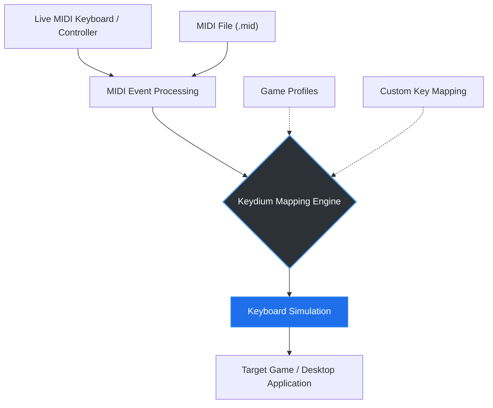

# 🎹 Keydium

**Your MIDI. Your Keys.**

*MIDI-to-keyboard software for games and desktop applications.*

---

## What is Keydium?

**Keydium** is a C++ desktop application designed to convert MIDI input from digital pianos and MIDI controllers into PC keyboard inputs.

It aims to bridge the gap between musical hardware and keyboard-based games or desktop applications. With MIDI-to-keyboard mapping, users can play virtual piano games using a physical MIDI keyboard instead of manually pressing keys on a computer keyboard.

Keydium is being developed with use cases such as:

- **Roblox Virtual Piano** — Play in-game virtual piano experiences using a physical piano or MIDI controller.
- **Genshin Impact** — Use a digital piano to play the Windsong Lyre.
- **Rhythm Games** — Map MIDI notes to keyboard controls.
- **Desktop Applications** — Convert MIDI notes into keyboard shortcuts and inputs.

> [!NOTE]
> **Hardware note:** Live MIDI input, device selection, channel filtering, note mapping to simulated PC keys, active-note visualisation and Panic are implemented. MIDI input ports are exclusive: if another application (browser Web MIDI, DAW, another Keydium instance) already holds the port, the open fails. On the Yamaha USB MIDI class driver under WinMM this surfaces as `MMSYSERR_NOMEM` (code 7), not the expected `MMSYSERR_ALLOCATED` (code 4) — close the other application and press Open MIDI again.

> [!NOTE]
> **Development status:** The live MIDI input to OS keyboard output pipeline is implemented and covered by automated tests. MIDI file playback is planned and is not yet available.

---

## Operating Modes

Keydium is designed around two main operating modes.

### 1. Live MIDI Input

Connect a physical MIDI keyboard, digital piano, or MIDI controller to send note events to Keydium.

Incoming MIDI Note On and Note Off events are decoded on the MIDI thread, filtered by channel (Omni or channels 1–16), and delivered to the mapping engine on the message thread. Mapped notes are translated into simulated PC keystrokes, with reference counting so several MIDI notes mapped to the same key never release it prematurely. A Panic control releases every simulated key instantly, and keys are also released automatically on device disconnect, device switch, mapping change and application shutdown.

Use cases include:

- Playing Roblox virtual piano games with a physical piano.
- Performing Genshin Impact's Windsong Lyre using MIDI hardware.
- Controlling keyboard-driven applications through custom MIDI mappings.

<badge>Implemented</badge>

### 2. MIDI File Playback

Load standard `.mid` files and automatically translate their musical events into keyboard inputs.

Planned capabilities include:

- **MIDI File Parsing:** Load and inspect standard MIDI files, including multi-track files.
- **Tempo and Timing:** Interpret note durations, tempo changes, and playback timing.
- **Playback Controls:** Control MIDI playback through the application.
- **Shared Mapping Profiles:** Use the same MIDI-to-keyboard mappings as live input.

<badge>Planned</badge>

---

## Key Features

### Implemented

- **Virtual Piano Interface:** Visual keyboard layouts supporting 49, 61, and 88 keys.
- **Octave Shifting:** Navigate different piano ranges through octave controls.
- **Custom Key Mapping Interface:** Configure MIDI note assignments to computer keyboard keys through a per-note mapping interface (right-click a virtual key to assign).
- **Live MIDI Input:** Device enumeration from the OS, hot-plug/disconnect handling, open/close control and per-channel filtering.
- **Keyboard Simulation:** MIDI events translated into operating-system-level keyboard inputs (Windows SendInput; X11 XTest on Linux), with duplicate-note suppression, shared-key reference counting and Panic.
- **Active-note Visualisation:** Virtual piano and PC-key matrix light up from real MIDI events.
- **Audio Monitoring:** Optional FluidSynth grand-piano sound (mono downmix) driven by the same note events.

### Planned Capabilities

- **Game-Specific Profiles:** Provide dedicated, switchable layouts for different games.
- **MIDI File Playback:** Automatically play `.mid` files through simulated keyboard inputs.
- **Unified Mapping Engine:** Share mapping configurations between live MIDI input and MIDI file playback.

---

## Game Profiles

Keydium is designed to support different mapping profiles depending on the target application.

| Profile | Target Application | Intended Mapping |
| :--- | :--- | :--- |
| **Genshin Impact** | Windsong Lyre | A layout based on the 21-key in-game lyre scale. |
| **Roblox** | Virtual Piano Games | Expanded keyboard mappings for virtual piano experiences. |
| **Custom** | Games and Desktop Apps | User-defined MIDI-to-keyboard assignments. |

The default mapping shipped with the application is the 21-note Genshin Windsong Lyre scale; per-note reassignment is available through the mapping interface. A dedicated profile switcher is still planned.

---

## Architecture & Workflow

Live MIDI input uses a shared mapping engine to process MIDI events and translate them into keyboard inputs. MIDI file playback is intended to use the same mapping configuration once implemented.

> [!IMPORTANT]
> The live MIDI input → mapping engine → keyboard simulation path is implemented. The MIDI file (.mid) branch of this diagram is planned and not yet implemented.

---

## Technology Stack

| Technology | Purpose |
| :--- | :--- |
| **C++17** | Core application development |
| **JUCE 7.0.9** | Desktop GUI, MIDI device input and event threading |
| **CMake 3.22+** | Build system |
| **FluidSynth 2.6.2** | Optional piano audio monitoring (SoundFont synthesis) |

---

## Development Roadmap

- [x] Initial desktop GUI prototype
- [x] Virtual piano interface
- [x] 49, 61, and 88-key layouts
- [x] Octave shifting interface
- [x] MIDI-to-keyboard mapping interface
- [x] Physical MIDI device input
- [x] MIDI Note On / Note Off processing
- [x] Operating-system-level keyboard simulation
- [x] Custom mapping configuration (per-note assignment)
- [ ] Functional Genshin Impact profile (profile switcher)
- [ ] Functional Roblox Virtual Piano profile
- [ ] MIDI file parsing and playback
- [ ] Unified live input and MIDI playback pipeline
- [ ] Application packaging and releases

---

## Project Status

Keydium is under active development. The core live MIDI input to keyboard output pipeline is implemented and verified by automated tests (hardware-free unit tests plus real-device open/close checks). The current focus is game compatibility, switchable game profiles and the planned MIDI file playback features.

Contributions, technical feedback, and suggestions are welcome as the project develops.

---

**Keydium — Your MIDI. Your Keys.**

